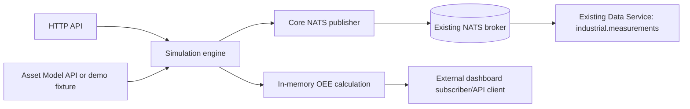

# Architecture

The service is a single Node.js process with four boundaries: HTTP lifecycle/configuration, an in-memory deterministic simulation engine, a read-only metadata adapter, and an asynchronous Core NATS publisher. No database is used for simulator state.

The lifecycle is `stopped → running ↔ paused → stopped`; reset clears in-memory counters and the current run. Simulation timestamps advance by `tickIntervalMs × speedMultiplier` only while running. Wall-clock `calculatedAt` remains real UTC time. Each transition produces a state event. Batch IDs correlate the simplified Mixer → Boiler_01 → Pump → Packager flow. The logical Boiler_Hub and Station01 report derived status only.

Metadata mode `asset-model` calls the discovered read-only `GET /assets`, then `GET /assets/{assetId}/variables`, extracting AssetVariable `id` and the joined variable-definition name/type/unit. Missing mappings are skipped (and therefore not persisted by `industrial.measurements`); `/api/v1/assets/{assetId}/variables` makes resolved mappings inspectable. Fixture mode uses synthetic UUID-shaped IDs and must not be mistaken for production IDs.

The browser control UI polls the Data Service `GET /measurements` range API every 2.5 seconds for the selected asset-variable ID and redraws a local SVG line chart. This is near-live polling, not a push stream. It can plot numeric mapped variables from any resolved asset, including Mixer_01's `mixing_speed` and `ingredient_weight`. The browser needs network access to Data Service and its CORS policy must allow the UI origin; the current Data Service permits cross-origin API calls.

NATS failure does not stop ticks. Core NATS messages are dropped while disconnected and counted. The NATS client reconnects; there is no durable queue. Shutdown stops the timer, closes open fault intervals, closes HTTP, and drains the NATS connection.
